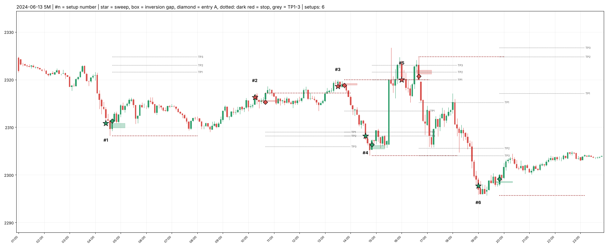
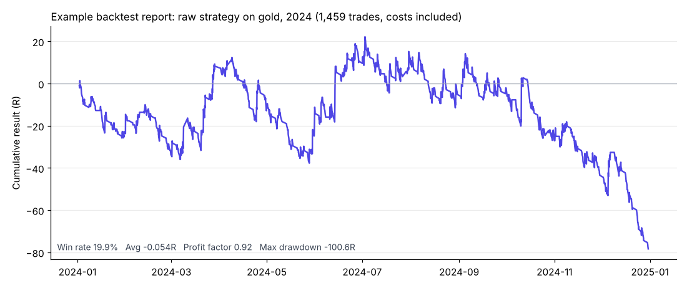

# Gold (XAUUSD) Strategy Backtester

A Python research tool that finds a specific intraday trading setup in years of 1-minute gold data, then simulates every trade minute by minute (with spread, conservative fills and built-in tests that prove it isn't "seeing the future").

It **only reads data**. It never places trades.

**Speed:** one full year of 1-minute gold data (354,801 candles) → **1,459 setups detected and simulated in about 3 minutes** on a modest 2-core machine. Loading the data takes about 5 seconds of that.


*One day of detected setups on the 5-minute chart. ★ = liquidity sweep, box = inversion gap (the confirmation), ◆ = entry, dark red dotted = stop, grey dotted = take-profit targets 1–3.*

---

## What makes the results trustworthy

Most retail backtests look better than reality because of small shortcuts. This one is built to avoid them:

- **Minute-by-minute simulation.** Trades are walked forward on 1-minute candles, so the tool sees the order things happened in instead of guessing.
- **Worst case when unsure.** If one candle touches both the stop and a target, the **stop** is counted first.
- **Real costs.** The broker's recorded spread is paid on every trade (a fixed $0.33 is assumed for years where the broker didn't record it). Stops and targets are checked on the correct side of the spread.
- **No free wins.** A trade still open when the data ends is dropped, not counted as a winner.
- **Look-ahead test.** A full audit found and fixed **six bugs** where the code had been using prices that hadn't happened yet. `test_pipeline.py --truncation` now proves they're gone: it takes real setups, deletes every candle that hadn't closed at the moment of entry, rebuilds each setup from scratch and checks the answer is identical.
- **A testing protocol fixed in advance.** Development used 2019–2024 only. 2025 onwards was held back until the strategy was locked (apart from a handful of days reviewed before that rule existed, which are logged), with pass criteria agreed before the run.

## Results

The honest answer is that this strategy has **no demonstrated edge**, and the tool is what proved it.

| Test | Average per trade | Profit factor | Verdict |
|---|---|---|---|
| Raw strategy, gold, 2024 (1,459 trades) | −0.054R | 0.92 | Losing |
| Locked strategy (with filter and "rule B" management), gold, 2025–26 holdout (567 trades) | 0.000R | 1.00 | Break-even, no edge |

*The filter keeps a setup only when an untouched opposing level from the 30-minute chart or higher sits closer than the first target. "Rule B" holds through TP1, moves the stop to break-even at TP2 and closes at TP3. Both were fixed before the holdout was run.*



**The look-ahead audit in action.** A second idea, "SMT divergence" (a sweep that a correlated market fails to confirm), first appeared to work on three out of three market pairs. The audit showed that the test checked the other market for up to 30 minutes after the sweep, about 20 minutes past the entry, so it was using information a trader wouldn't have had yet. With that fixed, the effect **reverses on all three**:

| Pair (traded / confirming) | Divergent, fixed | Confirmed, fixed | With the bug: divergent vs confirmed |
|---|---|---|---|
| Nasdaq / S&P 500 | −0.044R | −0.026R | +0.053R vs −0.061R |
| Dow / S&P 500 | −0.015R | −0.005R | +0.024R vs −0.027R |
| Gold / Silver | −0.092R | −0.069R | −0.047R vs −0.100R |

*Each pair: about 7,000–8,700 sweeps, Sep 2024 to Oct 2026, 0.25 price-unit round-trip cost.* `python smt_test.py ... --lookahead` switches the old bug back on, so both versions can be checked side by side.

*R = multiples of the amount risked on a trade. +1R means the trade won as much as it risked.*

---

## How it works

**The setup being tested:** price sweeps a liquidity level left by an earlier trend, then a fair value gap that formed after the sweep is closed through by a candle body (an "inversion gap"). Entry is at that candle's close, the stop goes behind the sweep, and targets are the nearest unswept 5M/15M swing points. At TP1 the stop moves to break-even, at TP2 to the TP1 price, and TP3 closes the trade.

| File | What it does |
|---|---|
| `download_history.py` | Downloads 1-minute and 5-minute candles from a MetaTrader 5 terminal into `data/` |
| `swings.py` | Swing high/low detection and candle-drawing helpers |
| `detectors.py` | ATR, multi-timeframe building, fair value gaps, sweeps |
| `levels.py` | Trend legs, liquidity levels, merging near-equal levels |
| `setups.py` | Combines a sweep with an inversion-gap confirmation into a setup |
| `backtest.py` | Minute-by-minute trade simulation and the results report |
| `test_pipeline.py` | Unit tests plus the look-ahead truncation test |
| `smt_test.py` | SMT divergence test for any pair of instruments |
| `locked_check.py` | Re-scores the locked strategy on a trades file |
| `management_test.py` | Compares trade-management rules on the same trades |
| `prop_eval.py` | Simulates prop-firm evaluation rules (drawdown, daily limit, target) |
| `delay_test.py`, `entry_test.py` | Pre-registered entry-timing experiments |
| `*_charts.py`, `blind_review.py` | Review charts, including "blind" charts that stop at the entry for unbiased labelling |

## Setup

Requires Python 3.10+.

```powershell
python -m venv .venv
.\.venv\Scripts\activate
pip install -r requirements.txt
```

### Get the data
Price data is **not included** (it comes from a broker). To download your own, open the MetaTrader 5 desktop terminal (Windows), log in, then run:

```powershell
$env:AGENT_SYMBOL = "XAUUSD"         # your broker's symbol name for gold
python download_history.py           # full history into data/
python download_history.py --update  # add the newest candles
```

Set `AGENT_SYMBOL` in the same window before running any script, so every script reads the same files (`data/XAUUSD_M1.csv` and `data/XAUUSD_M5.csv` in this example). Any CSV with the columns `time,open,high,low,close,tick_volume,spread,real_volume` works, so data from other sources can be used too.

### Run
```powershell
python test_pipeline.py                                          # fast unit tests (seconds)
python test_pipeline.py --truncation                             # look-ahead test on real data (minutes)
python backtest.py --from 2024-01-01 --to 2024-12-31 --label 2024
python setup_charts.py --dates 2024-06-13                        # chart the setups for a day
```

Results are saved to `results/` as a CSV of every trade, and a summary is printed (win rate, average R, profit factor, max drawdown, and breakdowns by direction, timeframe and more).

All times are the broker's **server time**.

---

## Disclaimer

This is a research and education project, **not financial advice**. It does not recommend any trade, and nothing here places orders. Past results, including backtests, do not predict future results.
